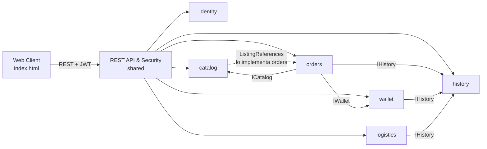

# SuperApp: Increment 1 (documento v2.0)

**Ingeniería de Software I · Universidad Nacional de Colombia · Docente: Magda Lucía Mejía Torres**
**Repositorio:** https://github.com/D13G0-G0/SuperApp · **Entrega:** 18 de noviembre de 2026

Este documento continúa el Entregable 1 (Requirements & Architecture, v0.1). Cuenta qué se construyó en el
Sprint 1, cómo se cumple lo prometido en requisitos y arquitectura, y qué queda para los siguientes sprints.

---

## 0. Historial de revisiones

| Versión | Fecha | Autores | Cambios |
|---|---|---|---|
| 0.1 | 01/10/2026 | Diego Andrés Rodríguez Cuaran, Marita Paola Urteaga Cueva | Borrador inicial (Entregable 1) |
| 2.0 | 18/11/2026 | Jesús David Cáceres Fonseca (redacción), Juan Sebastián Basabe Hernández (revisión) | Increment 1: lo que se implementó en el Sprint 1, estado de cada requisito y plan del Sprint 2 |

### Qué se entrega en el Increment 1

Una aplicación web para celular servida por un backend Spring Boot, que se levanta con `docker compose up`:

- **Cuenta y acceso:** registro, inicio de sesión con JWT, roles Cliente, Vendedor, Conductor y Administrador.
- **Marketplace:** publicar, editar, eliminar y buscar publicaciones.
- **Carrito y pago con la billetera:** en una sola transacción, con un pedido por vendedor.
- **Pedidos:** estados con transiciones controladas.
- **Billetera:** recarga simulada y movimientos inmutables.
- **Historial unificado:** filtrable por tipo y fecha.

### Cambios frente al Entregable 1

| Tema | Entregable 1 | Increment 1 | Por qué |
|---|---|---|---|
| Pago al vendedor (US-02, escenario 1) | El dinero se acredita al vendedor al pagar | El dinero queda **retenido** y se acredita al vendedor cuando el comprador confirma la entrega; si el pedido se cancela, vuelve al comprador | Una cancelación no obliga a quitarle dinero al vendedor (que podría ya no tenerlo) y el comprador queda protegido |
| Frontend | Aplicación de una sola página | Se mantiene: SPA en HTML, CSS y JavaScript sin framework (`index.html`), servida por el mismo backend | Cero pasos de compilación del frontend y un solo contenedor de aplicación |
| Caché Redis y nginx | En la vista de despliegue | Todavía no se usan | Con la carga del Sprint 1 no hacen falta; entran con NFR-01 y el despliegue con TLS (Sprint 2) |
| Ventas de una cuenta que solo es Vendedor | No se detallaba | Las ventas van en `/api/sales` y las compras en `/api/orders` | Una cuenta puede ser solo Vendedor, y `/api/orders` exige el rol Cliente |

---

## 1. Cobertura funcional

| Requisito | Qué hay en el Increment 1 | Dónde |
|---|---|---|
| **FR-01** Registro e inicio de sesión | Registro con nombre, correo y contraseña (mín. 8). Inicio de sesión que devuelve un JWT de 30 min. Cerrar sesión borra el token del dispositivo. | `identity` · pantalla de inicio de sesión |
| **FR-02** Roles | Cliente, Vendedor, Conductor y Administrador. Una cuenta puede ser Cliente y Vendedor a la vez. Nadie puede registrarse como Administrador. | `shared/security/SecurityConfig` |
| **FR-03** Publicaciones | Publicar, editar y eliminar (solo el dueño). Solo se publica con título, descripción, precio > 0, categoría y foto, y hay un mensaje por cada campo que falte. Si la publicación ya está en un pedido, se borra de forma lógica (DELETED). | `catalog` · "Vender" y "Mis publicaciones" |
| **FR-04** Búsqueda y filtros | Búsqueda por palabra clave, categoría y rango de precios (`minPrice`, `maxPrice`), con casillas de precio mínimo y máximo en la pantalla. Si el mínimo es mayor que el máximo, se avisa sin llamar al servidor. | `catalog` · Inicio |
| **FR-05** Carrito y pago | Carrito, y pago de todo el carrito con la billetera en **una transacción**. Crea un pedido por vendedor. Si algo ya se vendió, no cobra nada, lo quita del carrito y lo dice. Si no alcanza el saldo, no cambia nada y ofrece recargar. | `orders` · Pedidos → Carrito |
| **FR-06** Estados (pedidos) | Máquina de estados `PAID → SHIPPED → DELIVERED` y `PAID → CANCELLED`. Cada parte solo hace lo suyo: el vendedor envía, el comprador confirma la entrega y cualquiera cancela antes del envío. Una transición inválida devuelve 400 con la lista de estados permitidos. | `orders/domain/OrderStateMachine` · Pedidos → Compras/Ventas |
| **FR-07** Billetera | Recarga simulada con PayPal, Stripe o Cripto. Movimientos `TOP_UP`, `PAYMENT`, `INCOME` y `REFUND` que no se pueden editar ni borrar. El saldo nunca baja de 0. | `wallet` · Billetera |
| **FR-08** Historial unificado | Cada recarga, compra, venta, cambio de estado de un pedido y cambio de estado de un domicilio escribe una entrada para cada persona involucrada. Se lista del más reciente al más antiguo, con filtro por tipo y fechas. | `history` · Perfil → Ver mi historial |

### Historias de usuario del Sprint 1

- **US-01 (publicar un producto):** escenario 1 (publicación válida, visible en "Mis publicaciones" y en la búsqueda) y escenario 2 (sin foto o con precio ≤ 0: no se publica y hay un mensaje por campo). `ListingServiceTest` cubre las reglas del servicio; los mensajes por campo vienen de la validación del DTO (Bean Validation) y se ven en la pantalla "Vender". Una prueba automática de esos mensajes queda para el Sprint 2.
- **US-02 (comprar con la billetera):**
  - Escenario 1: pedido PAID, publicación SOLD, cobro al comprador y entradas de historial para comprador y vendedor. El abono al vendedor cambió a la entrega (ver §0).
  - Escenario 2: "La publicación ya no está disponible", sin pedido ni movimiento, y se quita del carrito.
  - Escenario 3: "Saldo insuficiente", con botón para recargar, y sin cambios.
  - Lo cubren `CheckoutApiTests` y `ConcurrentCheckoutTests`.
- **US-03, US-04 y US-05** dependen de envíos, panel financiero y administración, que son del Sprint 2 y el Sprint 3 (ver §5 y §7).

---

## 2. Cobertura de arquitectura

### Estilo: monolito modular

Se mantiene el estilo del Entregable 1. Hay un solo backend desplegable, organizado por módulos de negocio, y
cada módulo tiene las mismas capas:

```
controller  →  service  →  repository
   (DTO)      (dominio)     (JPA)
```

- **controller:** recibe y devuelve DTOs (`record` de Java) y nunca expone entidades. Valida con Bean Validation.
- **service:** reglas de negocio y transacciones (`@Transactional`).
- **domain:** entidades con sus reglas adentro. Por ejemplo, `WalletAccount.apply()` es la única forma de cambiar un saldo y rechaza que quede negativo.
- **repository:** Spring Data JPA.

### Módulos y cómo se hablan



Un módulo solo usa a otro a través de una **interfaz pública** en su paquete `api`, nunca de sus clases internas:

| Interfaz | Módulo dueño | La usa | Para qué |
|---|---|---|---|
| `IWallet` | wallet | orders | Cobrar (`debit`) y abonar (`credit`: INCOME o REFUND) |
| `ICatalog` | catalog | orders | Bloquear publicaciones para comprar, marcarlas vendidas y liberarlas |
| `IHistory` | history | wallet, orders, logistics | Anotar en el historial dentro de la misma transacción |
| `ListingReferences` | catalog | (la implementa orders) | Saber si una publicación está en un pedido antes de borrarla, sin que catalog dependa de orders |
| `CurrentUser` | shared | todos los controladores | Saber quién hace la petición (lee el JWT) |

### Patrones usados

| Patrón | Dónde | Para qué |
|---|---|---|
| **Strategy + Factory** | `wallet/payment` (`PaymentStrategy`, `PaymentStrategyFactory`) | Cada proveedor de pago simulado (PayPal, Stripe, Cripto) es una estrategia. Agregar uno no cambia la billetera. |
| **State Machine** | `orders/domain/OrderStateMachine` | Las transiciones válidas del pedido y quién puede hacer cada una en un solo lugar, sin base de datos (se prueba como lógica pura) |
| **Facade** | `catalog/service/CatalogFacade` (implementa `ICatalog`) | Da a orders solo las operaciones que necesita del catálogo |
| **Repository** | `*/repository` | Acceso a datos. Los repositorios de movimientos e historial **no** heredan de `JpaRepository`, así que no existe ningún método para editarlos ni borrarlos. |
| **DTO** | `*/dto` | La API nunca expone entidades JPA |
| **Inversión de dependencias** | `CurrentUser`, `ListingReferences`, `IWallet`, `ICatalog`, `IHistory` | Los módulos dependen de interfaces y no de implementaciones. Por ejemplo, la identidad se cambió de un header de prueba a JWT sin tocar los controladores. |

---

## 3. Persistencia

### Base de datos y migraciones

PostgreSQL 16. El esquema lo crea **Flyway** con migraciones versionadas, y Hibernate solo valida que las
entidades coincidan (`ddl-auto=validate`). Una migración que ya está en `main` no se edita nunca; los cambios
van en una migración nueva. Las pruebas usan las **mismas** migraciones sobre H2 en modo PostgreSQL, y la
prueba de concurrencia corre sobre PostgreSQL real.

| Migración | Contenido |
|---|---|
| `V1__identity_catalog` | `users`, `user_roles`, `listings`, `delivery_orders` (con `NOT NULL`, `UNIQUE` del correo, `CHECK` del precio > 0 y de los roles, y llaves foráneas) |
| `V2__seed` | Cuentas y publicaciones de prueba |
| `V3__password` | `password_hash` (BCrypt) |
| `V4__listing_deleted` | Estado `DELETED` para el borrado lógico |
| `V10__wallet` | `wallet_accounts` (una por usuario, `CHECK balance >= 0`) y `wallet_movements` (tipo, monto > 0, saldo resultante, referencia) |
| `V11__orders` | `cart_items` (único por usuario y publicación), `orders` (`CHECK` del estado y de comprador ≠ vendedor), `order_items` |
| `V12__history` | `history_events` (tipo, título, detalle, monto, referencia, fecha) |

Las migraciones se repartieron por persona para no chocar: V1–V9 la persona A y V10–V19 la persona B.

### La transacción del pago (NFR-02)

`CheckoutService.checkout()` es **una sola transacción ACID**:

1. Bloquea las publicaciones del carrito con `SELECT … FOR UPDATE`, en orden de id para que dos compras no se bloqueen entre sí (sin deadlocks).
2. Si alguna ya no está disponible, no escribe nada más: la quita del carrito y responde con un mensaje claro.
3. Crea un pedido por vendedor.
4. Cobra cada pedido de la billetera del comprador, bloqueando también su cuenta. Si no alcanza el saldo, **todo** se deshace.
5. Escribe el historial del comprador y del vendedor.
6. Marca las publicaciones como vendidas y vacía el carrito.

Como el bloqueo es por fila, una publicación solo se puede vender una vez aunque lleguen muchos pagos al mismo
tiempo. El historial y los movimientos se escriben **dentro** de esa transacción (`IHistory` exige una
transacción activa), así que nunca queda un "Compraste…" de una compra que se deshizo.

### Datos inmutables

Los movimientos de la billetera y las entradas del historial son `@Immutable`: Hibernate nunca los actualiza y
sus repositorios no tienen métodos para editar ni borrar. El saldo de una cuenta es siempre igual a la suma de
sus movimientos, y la prueba de concurrencia lo comprueba en todas las cuentas.

---

## 4. Requisitos no funcionales

| RNF | Meta del Entregable 1 | Qué se hizo y cómo se comprueba |
|---|---|---|
| **NFR-02** Consistencia | 200 pagos concurrentes de una misma publicación: exactamente 1 con éxito, 0 registros parciales, saldo = suma de movimientos en el 100 % de las cuentas | `ConcurrentCheckoutTests` lanza **200 hilos** a la vez contra **PostgreSQL 16 real** (Testcontainers). Comprueba 1 pago exitoso, 199 rechazos con "ya no está disponible", 1 solo pedido, publicación SOLD, un solo cobro, una compra y una venta en el historial, y saldo = suma de movimientos en todas las cuentas. **Si se quita el bloqueo de fila, la misma publicación se vende 10 veces y la prueba falla**, así que de verdad mide lo que dice. |
| **NFR-04** Seguridad | BCrypt costo ≥ 10, tokens ≤ 30 min, 401/403 en el 100 % de los endpoints protegidos, TLS ≥ 1.2, 0 hallazgos altos en OWASP ZAP | BCrypt costo 10. JWT HS256 que vence a los 30 min, con el secreto en la variable `JWT_SECRET`. Las pruebas comprueban 401 sin token y 403 con rol equivocado (`AuthSecurityTests`, `WalletApiTests`, `CheckoutApiTests`, `HistoryApiTests`). Quien no es parte de un pedido recibe 404, para no confirmar que existe. **Pendiente para el Sprint 2:** TLS (con el despliegue detrás de nginx) y el escaneo de OWASP ZAP. |
| **NFR-05** Mantenibilidad | ≥ 70 % de cobertura de líneas en la lógica de dominio; 0 violaciones de dependencias entre módulos en CI | **JaCoCo** en `./mvnw verify`, que falla si la cobertura total baja del 70 %. Hoy: **96,6 %** en las clases de dominio y **88,9 %** en todo el proyecto. Los módulos se hablan solo por interfaces (ver §2). **Pendiente:** una prueba automática de arquitectura (ArchUnit) que haga cumplir esa regla en CI. |
| **NFR-06** Usabilidad | Usable desde 360 px; prueba con ≥ 5 usuarios y SUS ≥ 70 | Todas las pantallas se probaron a **360 px** de ancho, sin scroll horizontal y con textos y botones grandes. Los errores dicen qué pasó y qué hacer ("Te faltan $X: recarga abajo"). **Pendiente:** la prueba con 5 usuarios y el cuestionario SUS. |
| **NFR-08** Portabilidad | `docker compose up` desde una copia limpia | `docker compose up --build` levanta PostgreSQL (con healthcheck) y la app. Flyway crea todo y carga los datos de prueba. GitHub Actions lo comprueba en cada pull request. |

### Pruebas automáticas

`./mvnw verify` corre **66 pruebas** (también en GitHub Actions en cada pull request):

| Clase | Pruebas | Qué cubre |
|---|---|---|
| `AuthSecurityTests` | 7 | Login, contraseña mala, 401 y 403 |
| `ListingServiceTest` | 9 | Reglas de publicación, edición, borrado y búsqueda |
| `WalletAccountTest` | 7 | Saldo = suma de movimientos, saldo insuficiente, montos inválidos |
| `WalletApiTests` | 8 | Recarga, errores por campo, permisos, billetera de un usuario nuevo |
| `OrderStateMachineTest` | 8 | Transiciones válidas e inválidas y quién puede hacer cada una |
| `CheckoutApiTests` | 12 | Carrito, pago, un pedido por vendedor, ya vendido, saldo insuficiente (rollback real), entrega y cancelación con su efecto en el dinero, 403 y 404 |
| `ConcurrentCheckoutTests` | 1 | 200 pagos simultáneos en PostgreSQL real |
| `HistoryApiTests` | 8 | Qué se anota, filtros, permisos, y que no se puede escribir fuera de una transacción |
| `DeliveryHistoryTests` | 3 | Los domicilios en el historial del cliente y del conductor; un cambio rechazado no deja registro |
| `SuperappApiApplicationTests` | 3 | Arranque, migraciones y datos de prueba |

---

## 5. Matriz de trazabilidad

| ID | Requisito | Módulo y componentes | Prueba o evidencia | Estado |
|---|---|---|---|---|
| FR-01 | Registro e inicio de sesión | identity: `AuthController`, `AuthService`, JWT | `AuthSecurityTests` | Implemented |
| FR-02 | Permisos por rol | shared: `SecurityConfig`, `CurrentUser` | `AuthSecurityTests` y pruebas 401/403 de cada módulo | Implemented |
| FR-03 | Gestión de publicaciones | catalog: `ListingController`, `ListingService` | `ListingServiceTest` | Implemented |
| FR-04 | Búsqueda y filtros | catalog: `ListingService.search`; Web Client (filtros) | `ListingServiceTest` | Implemented |
| FR-05 | Carrito y pago | orders: `CartService`, `CheckoutService`; catalog: `ICatalog`; wallet: `IWallet` | `CheckoutApiTests`, `ConcurrentCheckoutTests` | Implemented |
| FR-06 | Estados de pedidos, envíos y viajes | orders: `OrderStateMachine`, `OrderService` | `OrderStateMachineTest`, `CheckoutApiTests` | Implemented para pedidos; envíos y viajes en el Sprint 2 |
| FR-07 | Movimientos inmutables de la billetera | wallet: `WalletAccount`, `WalletMovement`, `WalletService` | `WalletAccountTest`, `WalletApiTests` | Implemented |
| FR-08 | Historial unificado | history: `IHistory`, `HistoryService`, `HistoryController`; lo usan wallet, orders y logistics | `HistoryApiTests`, `DeliveryHistoryTests` | Implemented |
| FR-09 | Panel financiero mensual | — | — | Deferred (Sprint 2) |
| FR-10 | Envíos y viajes con asignación simulada | logistics (base: entregas con conductor) | — | Deferred (Sprint 2) |
| FR-11 | Panel de administración | — | — | Deferred (Sprint 3) |
| FR-12 | Notificaciones en la aplicación | — | — | Deferred (Sprint 3) |
| NFR-01 | Desempeño (p95) | — | — | Deferred (Sprint 2: Redis y prueba de carga) |
| NFR-02 | Consistencia | orders + wallet + history en una transacción, bloqueo de fila | `ConcurrentCheckoutTests` | Implemented |
| NFR-03 | Disponibilidad y copias de seguridad | — | — | Deferred (Sprint 3) |
| NFR-04 | Seguridad | BCrypt, JWT, `SecurityConfig` | Pruebas 401/403 | Implemented (TLS y ZAP en el Sprint 2) |
| NFR-05 | Mantenibilidad | Módulos con interfaces públicas, JaCoCo | Informe de JaCoCo en `verify` | In Progress (falta la prueba de arquitectura) |
| NFR-06 | Usabilidad (360 px) | Web Client | Revisión a 360 px | Implemented (prueba SUS con usuarios en el Sprint 2) |
| NFR-07 | Compatibilidad de navegadores | Web Client | Probado en Chrome | Deferred (resto de navegadores en el Sprint 2) |
| NFR-08 | Portabilidad | `docker-compose.yml`, `Dockerfile` | Job "docker compose up" en CI | Implemented |

---

## 6. Cómo ejecutarlo

**Requisito:** Docker (Docker Desktop en Windows y macOS).

```bash
git clone https://github.com/D13G0-G0/SuperApp.git
cd SuperApp
docker compose up --build
```

Abrir **http://localhost:8080**. Para apagarlo: `Ctrl + C`. Para borrar también la base: `docker compose down -v`.

### Cuentas de prueba (contraseña de todas: `Demo1234`)

| Rol | Correo |
|---|---|
| Administrador | `admin@superapp.test` |
| Cliente | `cliente@superapp.test` |
| Cliente + Vendedor | `vendedor@superapp.test` |
| Conductor | `conductor@superapp.test` |

### Recorrido sugerido

1. Entrar con `cliente@superapp.test` → **Billetera** → recargar $500.000.
2. **Inicio** → abrir un producto → **Comprar ahora** → **Pagar con billetera**.
3. En otra ventana, entrar con `vendedor@superapp.test` → **Pedidos → Ventas** → **Marcar como enviado**.
4. Con el cliente: **Pedidos → Compras** → **Confirmar que lo recibí**. El vendedor recibe el dinero en ese momento.
5. **Perfil → Ver mi historial**: filtrar por tipo y fecha. El conductor tiene su historial en **Mis entregas**.

### Pruebas

```bash
cd backend
./mvnw verify
```

Necesita Java 21. La prueba de 200 pagos simultáneos necesita además Docker abierto (Testcontainers); sin
Docker, esa prueba se salta. El informe de cobertura queda en `backend/target/site/jacoco/index.html`.

---

## 7. Plan del Sprint 2

| Prioridad | Qué | Requisitos |
|---|---|---|
| 1 | **Envíos ligados a un pedido y viajes**, con asignación simulada de conductor y su propia máquina de estados (`REQUESTED → ASSIGNED → IN_TRANSIT → DELIVERED`). Partir de la base de entregas que ya existe en `logistics`. | FR-06, FR-10, US-03 |
| 2 | **Panel financiero mensual**: ingresos, gastos y saldo calculados desde los movimientos de la billetera | FR-09, US-04 |
| 3 | **Más pruebas**: prueba de arquitectura con ArchUnit en CI, más pruebas de `logistics`, prueba de carga para NFR-01 y escaneo de OWASP ZAP | NFR-01, NFR-04, NFR-05 |
| 4 | **Despliegue con nginx y TLS**, y caché de búsquedas con Redis | NFR-01, NFR-04 |
| 5 | **Usabilidad**: prueba con 5 usuarios y SUS; navegadores restantes | NFR-06, NFR-07 |

Para el Sprint 3: panel de administración (FR-11, US-05), notificaciones en la aplicación (FR-12) y copias de
seguridad automáticas con prueba de restauración (NFR-03).
